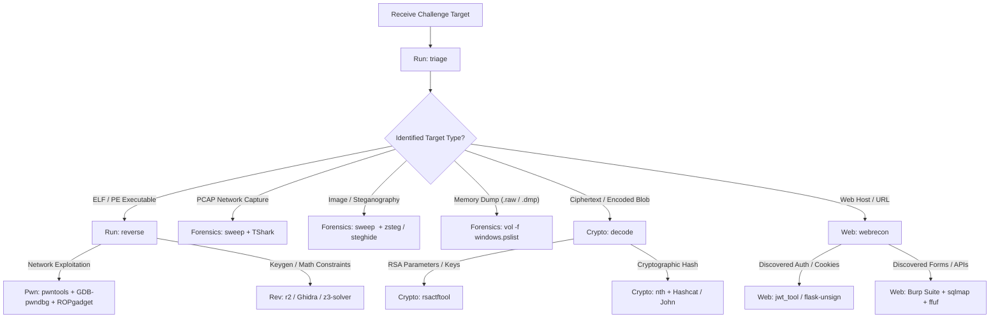

# CTF Competitor's Handbook & Toolchain Reference Manual

> **Environment:** Parrot Security OS 7.3 (echo) | **Workspace:** `/home/user` | **Python venv:** `~/ctf-venv`  
> **Consolidated Suite:** [`/home/user/Documents/ctf`](file:///home/user/Documents/ctf) | **GitHub Repository:** [nishanthrajs01-stack/ctf](https://github.com/nishanthrajs01-stack/ctf)  
> **Interactive Dashboard:** [ctf_dashboard.html](file:///home/user/Desktop/ctf_dashboard.html) (on Desktop)

---

## Table of Contents
1. [Workspace Architecture & Quick Access](#1-workspace-architecture--quick-access)
2. [Custom In-House Automation Tools (Hardened v2.0 Suite)](#2-custom-in-house-automation-tools-hardened-v20-suite)
   - [Tool Comparison & Selection Matrix](#tool-comparison--selection-matrix)
   - [triage.py — Universal First-Look File Triage](#triagepy--universal-first-look-file-triage)
   - [sweep.py — File-Type-Routed Forensics Sweep & Carving](#sweeppy--file-type-routed-forensics-sweep--carving)
   - [decode.py — Multi-Layer Crypto & Multi-Byte XOR Auto-Decoder](#decodepy--multi-layer-crypto--multi-byte-xor-auto-decoder)
   - [reverse.py — Sub-Second Binary Disassembly & Headless Ghidra](#reversepy--sub-second-binary-disassembly--headless-ghidra)
   - [webrecon.py — 4x Parallel High-Concurrency Web Recon](#webreconpy--4x-parallel-high-concurrency-web-recon)
3. [Core Cybersecurity Concepts to Master](#3-core-cybersecurity-concepts-to-master)
   - [File Formats, Polyglots & Shannon Entropy](#file-formats-polyglots--shannon-entropy)
   - [TCP Stream Reassembly & Steganography Theory](#tcp-stream-reassembly--steganography-theory)
   - [Cryptanalysis: Multi-Byte XOR, Frequency Analysis & IoC](#cryptanalysis-multi-byte-xor-frequency-analysis--ioc)
   - [Binary Protections, Stripped Entrypoints & Assembly](#binary-protections-stripped-entrypoints--assembly)
   - [Web Protocol Reconnaissance, Concurrency & Liveness](#web-protocol-reconnaissance-concurrency--liveness)
4. [Integrated 5-Stage CTF Challenge Walkthrough](#4-integrated-5-stage-ctf-challenge-walkthrough)
5. [Standalone Tool Suites (`~/tools/`)](#5-standalone-tool-suites-tools)
   - [RsaCtfTool (`rsactftool` / `rsacrack`)](#rsactftool-rsacrack)
   - [jwt_tool](#jwt_tool)
   - [CyberChef (Offline Browser Suite)](#cyberchef-offline-browser-suite)
   - [PayloadsAllTheThings](#payloadsallthethings)
   - [pwndbg](#pwndbg)
   - [pyinstxtractor](#pyinstxtractor)
6. [Python CTF Virtual Environment (`~/ctf-venv`)](#6-python-ctf-virtual-environment-ctf-venv)
   - [pwntools](#pwntools)
   - [z3-solver](#z3-solver)
   - [gmpy2 & sympy](#gmpy2--sympy)
   - [pycryptodome & cryptography](#pycryptodome--cryptography)
   - [ropper & ROPgadget](#ropper--ropgadget)
   - [scapy](#scapy)
7. [Binary Exploitation (Pwn) & Reversing Reference](#7-binary-exploitation-pwn--reversing-reference)
   - [Ghidra (GUI & Headless)](#ghidra)
   - [Radare2 (r2)](#radare2-r2)
   - [checksec](#checksec)
   - [one_gadget](#one_gadget)
   - [jadx & apktool (Android)](#jadx--apktool-android)
   - [upx & dynamic tracing (ltrace / strace)](#upx--dynamic-tracing)
8. [Forensics & Steganography Reference](#8-forensics--steganography-reference)
   - [Wireshark & TShark](#wireshark--tshark)
   - [Volatility 3 (`vol`)](#volatility-3-vol)
   - [binwalk & foremost](#binwalk--foremost)
   - [zsteg & steghide](#zsteg--steghide)
   - [oletools & exiftool](#oletools--exiftool)
9. [Cryptography & Password Cracking Reference](#9-cryptography--password-cracking-reference)
   - [Hashcat & John the Ripper](#hashcat--john-the-ripper)
   - [Name-That-Hash (`nth`)](#name-that-hash-nth)
   - [Wordlists & SecLists](#wordlists--seclists)
10. [Web Application Security Reference](#10-web-application-security-reference)
    - [Burp Suite](#burp-suite)
    - [sqlmap](#sqlmap)
    - [ffuf & gobuster](#ffuf--gobuster)
    - [flask-unsign](#flask-unsign)
    - [nmap](#nmap)
11. [Competitive CTF Playbook & Decision Matrix](#11-competitive-ctf-playbook--decision-matrix)

---

## 1. Workspace Architecture & Quick Access

The competition environment is partitioned into categorized working directories to isolate artifacts, reports, and scripts during matches:

```
/home/user/
├── Documents/
│   └── ctf/                  # Consolidated repository root (Git synced)
│       ├── triage.py         # Tool #1: Universal first-look file triage
│       ├── sweep.py          # Tool #2: Type-routed forensics & carving
│       ├── decode.py         # Tool #3: Multi-layer crypto & XOR decoder
│       ├── reverse.py        # Tool #4: Radare2 + Headless Ghidra disassembler
│       ├── decompile_dump.py # Helper: Ghidra Jython post-script
│       ├── webrecon.py       # Tool #5: 4x Parallel web reconnaissance
│       └── index.html        # Interactive Command Center Dashboard
├── ctf/
│   ├── challenge/            # 5-Stage local CTF challenge scenario
│   ├── crypto/               # Cryptanalysis scripts, outputs, decode_report.txt
│   ├── forensics/            # Carved artifacts, PCAP dumps, memory extractions
│   ├── misc/                 # Triage reports, one-off scripts, custom tokens
│   ├── osint/                # OSINT notes, scraped intel, target mappings
│   ├── pwn/                  # Exploit scripts, cyclic patterns, ROP payloads
│   ├── rev/                  # Reverse engineering reports, decompiled C code
│   ├── tools/                # Source tools symlinked into ~/.local/bin
│   └── web/                  # Web scan logs, fuzzing reports, request dumps
├── tools/                    # Cloned external suites (RsaCtfTool, jwt_tool, CyberChef)
├── ctf-venv/                 # Python 3.13 venv containing pwntools, z3, scapy, etc.
└── Desktop/
    ├── ctf.md                # This comprehensive handbook
    ├── ctf_dashboard.html    # Standalone interactive dashboard UI
    ├── mystery.chall         # Generated master challenge entrypoint
    └── CHALLENGE_WALKTHROUGH.md # 5-in-1 challenge step-by-step solution
```

### Essential Shell Shortcuts & Aliases ([.ctf_aliases](file:///home/user/.ctf_aliases))
| Command / Variable | Target / Definition | Purpose |
| :--- | :--- | :--- |
| `ctfenv` | `source ~/ctf-venv/bin/activate` | Activate Python virtual environment with all security libraries |
| `serve` | `python3 -m http.server 8000` | Instantly host local directory over HTTP for file transfers |
| `cyberchef` | `xdg-open ~/tools/CyberChef/index.html` | Open local offline CyberChef in browser |
| `triage <file>` | [`~/ctf/tools/triage.py`](file:///home/user/ctf/tools/triage.py) | Run universal first-look file triage |
| `sweep <file>` | [`~/ctf/tools/sweep.py`](file:///home/user/ctf/tools/sweep.py) | Run type-routed forensics sweep |
| `decode <str>` | [`~/ctf/tools/decode.py`](file:///home/user/ctf/tools/decode.py) | Run multi-layer crypto auto-decoder |
| `reverse <bin>` | [`~/ctf/tools/reverse.py`](file:///home/user/ctf/tools/reverse.py) | Run binary disassembler & mitigation check |
| `webrecon <url>` | [`~/ctf/tools/webrecon.py`](file:///home/user/ctf/tools/webrecon.py) | Run parallel 4x web reconnaissance |
| `$ROCKYOU` | `/usr/share/wordlists/rockyou.txt` | Path to 134MB standard password dictionary |
| `$SECLISTS` | `/usr/share/seclists` | Path to SecLists root collection |

---

## 2. Custom In-House Automation Tools (Hardened v2.0 Suite)

All 5 tools are located in [`~/Documents/ctf/`](file:///home/user/Documents/ctf) (and [`~/ctf/tools/`](file:///home/user/ctf/tools)), marked executable (`+x`), and symlinked directly into `~/.local/bin` for system-wide execution.

### Tool Comparison & Selection Matrix

| # | Tool | Primary Category | Typical Input | Avg Runtime | Key Capabilities |
| :---: | :--- | :--- | :--- | :---: | :--- |
| **1** | **`triage`** | Triage / Recon | Any unknown file or archive | **~4.8s** | Sliding-window chunk entropy, streaming flag regex, binwalk headers, category verdict. |
| **2** | **`sweep`** | Forensics / Stego | PCAPs, images, nested archives | **~2.6s** | Top 5 TCP stream reassembly, Steghide dictionary attack, binary-safe carving. |
| **3** | **`decode`** | Cryptography | Ciphertext, Hex, BaseXX, XOR | **~1.3s** | Known-prefix & statistical multi-byte XOR, Base32/64/85, URL, noise pruning. |
| **4** | **`reverse`** | Reversing / Pwn | ELF / PE binaries (x86/x64) | **~1.5s** | Sub-second Radare2 disassembly, stripped binary `entry0` fallback, Headless Ghidra. |
| **5** | **`webrecon`** | Web Security | HTTP/HTTPS URL, IP, hostname | **~21.4s** | 2s TCP liveness probe, 4x parallel Nmap, WhatWeb, Gobuster, Nikto, auto-insecure TLS. |

---

### [triage.py](file:///home/user/Documents/ctf/triage.py) — Universal First-Look File Triage

Run immediately upon downloading any challenge artifact to classify target type, identify compression/encryption, and locate un-obfuscated flags.

```bash
triage <challenge_file>
# Example:
triage /home/user/Desktop/mystery.chall
```

#### Key Architecture & Capabilities:
1. **Sliding-Window Block Entropy (1024-byte chunks):** Calculates minimum, average, and maximum entropy across sliding blocks. Detects localized encrypted payloads or packed shellcode blocks inside large zero-padded or asset-heavy files.
2. **Streaming Regex Engine:** Streams `strings` directly into regular expression matchers without line truncation limits, catching long flags in large binaries.
3. **Multi-Format Flag Matcher:** Recognizes standard curly-brace flags (`CTF{...}`, `flag{...}`), custom prefixes (`37C3_...`), and key-value formats (`FLAG: secret_token`).
4. **Automated Category Verdict:** Evaluates magic bytes, EXIF metadata, and Binwalk signatures to output actionable CTF category guidance (e.g. Reverse, Pwn, Crypto, Forensics).
5. **Persistent Output:** Automatically writes full report to [`~/ctf/misc/triage_<filename>.txt`](file:///home/user/ctf/misc).

---

### [sweep.py](file:///home/user/Documents/ctf/sweep.py) — File-Type-Routed Forensics Sweep & Carving

Intelligent forensics triage engine that detects target file kind and executes category-specific extraction pipelines.

```bash
sweep <evidence_file>
# Example:
sweep ~/ctf/forensics/sweep_mystery/_mystery.chall.extracted/traffic.pcap
```

#### Routing Pathways:
* **PCAP / Network Captures:**
  - Validates packet count and header integrity.
  - Automatically exports HTTP objects to `http_objects/`.
  - Extracts all DNS query names and captured POST credentials/Bearer tokens.
  - Follows and dumps ASCII text across top 5 active TCP streams (Streams 0–4).
* **Images (PNG, JPG, BMP, WEBP):**
  - Executes `zsteg -a` across all bit planes and colour channels.
  - Runs a dictionary attack against `steghide` using top-20 CTF passwords (`password`, `admin`, `secret`, `123456`, `stego`, `hackme`, `hidden`, etc.).
  - Extracts EXIF tags, GPS metadata, and embedded comments.
* **Archives & Binaries:**
  - Executes `binwalk -e --dd=".*"` recursive extraction.
  - Executes `foremost` file carving.
  - Uses binary-safe subprocess decoders (`errors="replace"`) to eliminate non-UTF8 continuation byte crashes.
* **Recursive Flag Sweeper:** Scans all carved subdirectories for flag patterns and saves full report to [`~/ctf/forensics/sweep_<basename>/sweep_report.txt`](file:///home/user/ctf/forensics).

---

### [decode.py](file:///home/user/Documents/ctf/decode.py) — Multi-Layer Crypto & Multi-Byte XOR Auto-Decoder

Automated recursive decoder for nested encodings and statistical cryptanalysis.

```bash
# Direct string decoding:
decode "UEdTezVfZzAweTVfMV96NDVnM2VfcHU0MWFfcDB6Y3kzZzN9"

# From file with custom search depth:
decode -f ciphertext.txt --depth 3 --top 10
```

#### Key Algorithms & Features:
1. **Multi-Byte XOR Cracking:**
   - *Known-Prefix Derivation:* Uses known CTF prefixes (`CTF{`, `flag{`, `FLAG{`) to derive candidate keys of lengths 2 through 8.
   - *Statistical Frequency Solver:* Partitions ciphertext into $k$ interleaved byte slices and recovers the most probable key bytes via English character frequency scoring.
2. **Comprehensive Encoding Matrix:** Supports Base64, Base32, Base85/Ascii85, Hexadecimal, Binary ASCII, ROT1–25, URL percent-decoding, Single-Byte XOR (`0x00–0xFF`), and Multi-Byte XOR.
3. **English Frequency & Noise Pruning:** Computes printable character ratios and rewards natural English letter distributions while heavily penalizing non-printable control characters to prevent combinatorial explosion.
4. **Persistent Ranking:** Deduplicates candidate chains and writes top candidates to [`~/ctf/crypto/decode_report.txt`](file:///home/user/ctf/crypto/decode_report.txt).

---

### [reverse.py](file:///home/user/Documents/ctf/reverse.py) — Sub-Second Binary Disassembly & Headless Ghidra

Rapid binary orientation pipeline combining instant Radare2 disassembly with deep Ghidra decompilation.

```bash
# Fast-path triage (< 1.5 seconds):
reverse /home/user/ctf/challenge/keychecker

# Deep Headless Ghidra C pseudocode decompilation:
reverse /home/user/ctf/challenge/keychecker --ghidra --timeout 120
```

#### Key Capabilities:
1. **Sub-Second Radare2 Disassembly:** Instantly disassembles `sym.main` / `main` and prints symbol tables in < 1.5s, eliminating heavy JVM startup latency during fast triage.
2. **Stripped Binary Fallback:** If debug symbols are stripped, automatically inspects entry point (`entry0`), traces `__libc_start_main` setup parameters, and lists top discovered functions (`fcn.*`).
3. **Exploit Mitigation Audit (`checksec`):** Verifies Stack Canary, NX (No-Execute stack), PIE (Position Independent Executable), and RELRO status. Emits specific exploitation verdicts (e.g. buffer overflow viability, ROP necessity).
4. **Headless Ghidra Integration:** When `--ghidra` is passed, executes `analyzeHeadless` with [decompile_dump.py](file:///home/user/ctf/tools/decompile_dump.py) to extract complete C pseudocode to [`~/ctf/rev/reverse_<basename>.txt`](file:///home/user/ctf/rev).

---

### [webrecon.py](file:///home/user/Documents/ctf/webrecon.py) — 4x Parallel High-Concurrency Web Recon

High-speed web reconnaissance engine that reduces full scan turnaround from >2.5 minutes down to <21 seconds.

```bash
# Standard scan against web service:
webrecon http://127.0.0.1:9191

# Skip nikto for ultra-fast rounds:
webrecon http://10.10.10.99:8080 --no-nikto --timeout 15
```

#### Key Capabilities:
1. **2-Second Pre-Flight Socket Liveness Check:** Probes the target host and port with raw TCP sockets. If the host is unrouteable, filtered, or dead, it aborts in <2.3s, preventing worker threads from hanging for 2 minutes.
2. **4x Concurrent ThreadPool Execution:** Dispatches `nmap -sV`, `whatweb`, `gobuster` (directory enumeration via SecLists), and `nikto` in parallel worker threads.
3. **Auto-Insecure TLS Handling:** Automatically passes `-k` (gobuster/ffuf) and `--insecure` flags when target scheme is HTTPS.
4. **Integrated Flag Grep:** Scans all tool outputs and discovered HTTP responses for flag patterns and saves consolidated report to [`~/ctf/web/webrecon_<target>.txt`](file:///home/user/ctf/web).

---

## 3. Core Cybersecurity Concepts to Master

### File Formats, Polyglots & Shannon Entropy

* **Magic Bytes (File Signatures):** Files are defined by their first few bytes (the signature), not their file extension.
  * ELF Binary: `7f 45 4c 46` (`\x7fELF`)
  * Zip Archive: `50 4b 03 04` (`PK\x03\x04`)
  * PNG Image: `89 50 4e 47 0d 0a 1a 0a`
  * JPEG Image: `ff d8 ff e0` / `ff d8 ff e1`
  * PDF Document: `25 50 44 46` (`%PDF`)
* **Polyglot Files:** Files crafted to be valid in multiple formats simultaneously (e.g., a valid PNG image that also contains a valid Zip archive at the end). `binwalk` scans byte-by-byte to find embedded headers.
* **Shannon Entropy ($H$):** Measures the randomness/unpredictability of data in bits per byte ($0.0 \le H \le 8.0$):
  * $0.0 - 3.0$: Repetitive, sparse data, zero-padding, plain ASCII.
  * $3.0 - 5.5$: Standard English text, uncompressed source code, compiled x86/x64 assembly.
  * $7.2 - 8.0$: High-entropy data: encrypted payloads (AES, ChaCha20, high-entropy XOR), compressed archives (Zip, Gzip, 7z), or packed binaries (UPX).
  * **Sliding-Window Analysis:** Evaluates entropy across 1024-byte sub-blocks. A file with overall entropy $3.2$ that contains a 2KB block with entropy $7.85$ reveals an embedded encrypted payload.

---

### TCP Stream Reassembly & Steganography Theory

* **TCP Packet Fragmentation & Reassembly:** TCP breaks large data transfers across multiple IP packets. In PCAP forensics, viewing individual packets only shows fragments. Following the full TCP conversation (Stream 0, Stream 1, etc.) reassembles full HTTP transactions, authorization headers, and transferred files.
* **Steganography (Stego):**
  * **LSB (Least Significant Bit):** Modifies the lowest bit of pixel color bytes (RGB). The visual difference is imperceptible to human eyes, but extracting the LSB plane recovers hidden ASCII or files (`zsteg`).
  * **Steghide:** Embeds data inside JPEG DCT coefficients or WAV audio samples, protected by a passphrase.

---

### Cryptanalysis: Multi-Byte XOR, Frequency Analysis & IoC

* **Encoding vs. Encryption:**
  * *Encoding* (Base64, Base32, Hex, URL) transforms data for transmission using public algorithms; no secret key is required.
  * *Encryption* uses mathematical transformations parameterized by a secret key.
* **XOR Cipher ($C_i = P_i \oplus K_{i \pmod k}$):**
  * Symmetric: $P_i = C_i \oplus K_{i \pmod k}$.
  * **Single-Byte XOR ($k=1$):** Every byte is XORed with a constant ($0\text{x}00 - 0\text{xFF}$).
  * **Multi-Byte Repeating XOR ($k > 1$):** A key of length $k$ (e.g. `b'KEY'`) repeats across the text.
* **Index of Coincidence (IoC) & Letter Frequency:**
  * Standard English text has an IoC of $\approx 0.0667$, while random noise has an IoC of $\approx 0.0385$.
  * English letter frequencies (`e` $\approx 12.0\%$, `t` $\approx 9.1\%$, `a` $\approx 8.1\%$, `o` $\approx 7.7\%$, `i` $\approx 7.3\%$) allow statistical recovery of multi-byte keys by breaking ciphertext into $k$ interleaved single-byte slices and evaluating candidate scores.

---

### Binary Protections, Stripped Entrypoints & Assembly

* **Exploit Mitigations (Checksec):**
  * **Stack Canary (`__stack_chk_fail`):** A random guard integer placed on the stack before the saved frame pointer (`RBP`) and return address (`RIP`). Corrupting it triggers an instant abort.
  * **NX (No-Execute) / DEP:** Marks stack and heap memory pages as non-executable. Injected shellcode cannot execute; exploits must use Return-Oriented Programming (ROP) or `ret2libc`.
  * **PIE (Position Independent Executable) & ASLR:** Randomizes code segment base addresses on execution. Hardcoded function addresses cannot be used without an information leak.
  * **RELRO (Relocation Read-Only):**
    * *Partial RELRO:* ELF internal data (`.got`) precedes program data, but the Global Offset Table (`.got.plt`) is writable (GOT overwrite attacks viable).
    * *Full RELRO:* Entire GOT is marked read-only at startup (GOT overwrite impossible).
* **Stripped vs. Non-Stripped Binaries:**
  * In non-stripped binaries, symbol names (`main`, `check_key`) exist in the symbol table.
  * In stripped binaries, debug symbols are removed. Execution starts at `entry0` (`_start`), which places the address of the real `main` function into `RDI` / `RCX` and calls `__libc_start_main`.

---

### Web Protocol Reconnaissance, Concurrency & Liveness

* **HTTP Response Codes:**
  * `200 OK`: Resource accessible.
  * `301 / 302 / 307`: Redirects (often leading to internal login panels or auth portals).
  * `401 Unauthorized` / `403 Forbidden`: Endpoint exists but requires elevated privileges or header bypasses (`X-Forwarded-For: 127.0.0.1`).
  * `404 Not Found`: Route does not exist.
* **Concurrency & Socket Liveness:** Running web enumeration tools in parallel requires host responsiveness. Attempting multi-threaded scans against dropped or rate-limited ports exhausts worker threads. Performing pre-flight socket probes avoids blocking on non-existent routes.

---

## 4. Integrated 5-Stage CTF Challenge Walkthrough

The workspace includes a self-contained 5-stage challenge pipeline that demonstrates how all 5 custom automation tools chain together to recover a final flag.

```
                         [ mystery.chall (Desktop) ]
                                      │
                                      ▼ 1. triage mystery.chall
                         [ Detected: Prepended Zip Archive ]
                                      │
                                      ▼ 2. sweep mystery.chall
                         [ Extracted: keychecker + traffic.pcap ]
                                      │
                 ┌────────────────────┴────────────────────┐
                 │                                         │
                 ▼ 2b. sweep traffic.pcap                  ▼ 3. reverse keychecker
       [ Dissect TCP Stream 0 ]                  [ Radare2 Fast Disassembly ]
       [ Port: 9191 | Bearer Hint ]              [ Recover XOR Key: w3b_v4ult_k3y ]
                 │                               [ Output: PORT=9191 PASS=unlocked ]
                 └────────────────────┬────────────────────┘
                                      │
                                      ▼ 4. webrecon http://127.0.0.1:9191
                         [ Discovered Route: /vault ]
                         [ Payload: UEdTezVfZzAweTVfMV96NDVnM2V... ]
                                      │
                                      ▼ 5. decode "UEdTezVfZzAweTVfMV96NDVnM2V..."
                         [ Decodes Base64 -> ROT13 ]
                                      │
                                      ▼
             [ FLAG: CTF{5_t00l5_1_m45t3r_ch41n_c0mpl3t3} ]
```

### Reset & Verification Command:
```bash
/home/user/ctf/challenge/setup_challenge.py
```

---

## 5. Standalone Tool Suites (`~/tools/`)

### [RsaCtfTool](file:///home/user/tools/RsaCtfTool/) (`rsactftool` / `rsacrack`)
Automated framework for attacking broken RSA public keys and ciphertexts.
* **Commands:**
  ```bash
  rsactftool -n <modulus> -e <exponent> --attack <attack_name> --private
  rsactftool --publickey <pub.pem> --decryptfile <cipher.bin>
  rsactftool -n <modulus> -e <exponent> --attack all
  ```
* **Supported Attacks:** Fermat factorization ($p \approx q$), Wiener's small $d$ attack, Boneh-Durfee, Pollard $p-1$, FactorDB API lookup, Hastad's broadcast attack, Common Modulus attack.

---

### [jwt_tool](file:///home/user/tools/jwt_tool/) (`jwt_tool`)
Toolkit for auditing, tampering, and attacking JSON Web Tokens (RFC 7519).
* **Commands:**
  ```bash
  jwt_tool <jwt_token>
  jwt_tool <jwt_token> -t "https://target.com/api" -rh "Authorization: Bearer ..." -M at
  jwt_tool <jwt_token> -C -d $ROCKYOU
  ```

---

### [CyberChef (Offline Browser Suite)](file:///home/user/tools/CyberChef/index.html)
Browser-based encryption, compression, and encoding workstation.
* **Launch:** Type `cyberchef` in terminal (opens [`~/tools/CyberChef/index.html`](file:///home/user/tools/CyberChef/index.html)).

---

### [PayloadsAllTheThings](file:///home/user/tools/PayloadsAllTheThings/)
Comprehensive offline cheat sheets and injection bypass payloads.
* **Location:** [`/home/user/tools/PayloadsAllTheThings/`](file:///home/user/tools/PayloadsAllTheThings/)
* **Key Sections:** SQL Injection, Command Injection, Server-Side Template Injection (SSTI), XSS, XXE, File Inclusion.

---

### [pwndbg](file:///home/user/tools/pwndbg/)
GDB plugin for binary exploitation, heap analysis, and assembly tracing.
* **Launch:** `gdb ./binary` (pwndbg loads automatically).

---

### [pyinstxtractor](file:///home/user/tools/pyinstxtractor/)
Extracts Python bytecode (`.pyc`) from compiled PyInstaller executables.
* **Command:** `python3 ~/tools/pyinstxtractor/pyinstxtractor.py target.exe`

---

## 6. Python CTF Virtual Environment (`~/ctf-venv`)

Activate the dedicated Python environment via:
```bash
ctfenv
# or: source /home/user/ctf-venv/bin/activate
```

### Installed Core Python Libraries:
* **`pwntools`:** Binary exploitation, socket I/O, cyclic pattern generation, ELF parsing, shellcode assembly, ROP construction.
* **`z3-solver`:** SMT constraint solver for keygen reversing and mathematical constraint challenges.
* **`gmpy2` & `sympy`:** High-precision arithmetic and number theory functions for cryptographic attacks (discrete logs, polynomial roots, modular inverses).
* **`pycryptodome` & `cryptography`:** Implementation of AES, DES, RSA, ECC, ChaCha20, HMAC, and SHA hashing algorithms.
* **`ropper` & `ROPgadget`:** Disassembles binaries to search for ROP/JOP gadgets and generate automated ROP chains.
* **`scapy`:** Network packet creation, dissection, and PCAP manipulation.

---

## 7. Binary Exploitation (Pwn) & Reversing Reference

### [checksec](file:///usr/bin/checksec)
```bash
checksec --file=./binary
```

### [Radare2](file:///usr/bin/r2) (`r2`)
```bash
r2 -d ./binary          # Start in debug mode
aa                      # Analyze all symbols and calls
afl                     # List all functions
pdf @ main              # Disassemble function main
pdf @ entry0            # Disassemble entrypoint
```

### [one_gadget](file:///home/user/.local/bin/one_gadget)
Finds single `execve('/bin/sh', ...)` jump offsets within `libc.so.6`.
```bash
one_gadget /lib/x86_64-linux-gnu/libc.so.6
```

### [jadx](file:///usr/bin/jadx) & [apktool](file:///usr/bin/apktool)
```bash
jadx-gui app.apk        # Decompile Android APK to Java source in GUI
apktool d app.apk       # Disassemble APK resources and Smali code
```

### Dynamic Tracing
```bash
ltrace ./binary         # Intercept dynamic library calls (strcmp, ptraces)
strace ./binary         # Intercept Linux kernel system calls (read, write, open)
```

---

## 8. Forensics & Steganography Reference

### [Wireshark](file:///usr/bin/wireshark) & [TShark](file:///usr/bin/tshark)
```bash
# Export HTTP files:
tshark -r capture.pcap --export-objects "http,./extracted_objects"

# Extract all DNS queries:
tshark -r capture.pcap -Y "dns" -T fields -e dns.qry.name

# Follow TCP stream 0:
tshark -r capture.pcap -q -z follow,tcp,ascii,0
```

### [Volatility 3](file:///home/user/.local/bin/vol) (`vol`)
Memory dump forensics framework.
```bash
vol -f memory.dmp windows.pslist        # List processes
vol -f memory.dmp windows.cmdline       # View command lines
vol -f memory.dmp windows.filescan      # Scan memory for file objects
vol -f memory.dmp windows.dumpfiles --virtaddr <offset> # Dump file from memory
```

### [binwalk](file:///usr/bin/binwalk) & [foremost](file:///usr/bin/foremost)
```bash
binwalk -e --dd=".*" challenge_file     # Recursive extraction
foremost -i evidence.raw -o ./carved/   # Header-trailer carving
```

### [zsteg](file:///usr/local/bin/zsteg) & [steghide](file:///usr/bin/steghide)
```bash
zsteg -a image.png                      # Scan all PNG bitplanes
steghide extract -sf image.jpg -p "pass" # Extract Steghide payload
```

---

## 9. Cryptography & Password Cracking Reference

### [Hashcat](file:///usr/bin/hashcat) & [John the Ripper](file:///usr/sbin/john)
```bash
# Hashcat dictionary attack:
hashcat -m 0 hashes.txt $ROCKYOU        # MD5
hashcat -m 1000 hashes.txt $ROCKYOU     # NTLM
hashcat -m 1800 hashes.txt $ROCKYOU     # SHA512crypt (Linux shadow)

# John the Ripper:
john --wordlist=$ROCKYOU hashes.txt
john --show hashes.txt
```

### [Name-That-Hash](file:///home/user/.local/bin/nth) (`nth`)
```bash
nth --text '5f4dcc3b5aa765d61d8327deb882cf99'
```

---

## 10. Web Application Security Reference

### [sqlmap](file:///usr/bin/sqlmap)
```bash
sqlmap -u "http://target.ctf/item?id=1" --batch --dbs
sqlmap -r request.txt -p id --level=3 --risk=2 --dbs
```

### [ffuf](file:///usr/bin/ffuf) & [gobuster](file:///usr/bin/gobuster)
```bash
# Directory discovery:
ffuf -u http://target.ctf/FUZZ -w $SECLISTS/Discovery/Web-Content/common.txt -mc 200,301,302
gobuster dir -u http://target.ctf/ -w $SECLISTS/Discovery/Web-Content/common.txt -x php,txt,html
```

### [flask-unsign](file:///home/user/.local/bin/flask-unsign)
```bash
flask-unsign --decode --cookie '<cookie_value>'
flask-unsign --unsign --cookie '<cookie_value>' --wordlist $ROCKYOU
flask-unsign --sign --cookie "{'admin': True}" --secret '<discovered_key>'
```

---

## 11. Competitive CTF Playbook & Decision Matrix

When approaching a challenge during live competition, follow this systematic workflow:



### Golden Rules for High-Speed CTF Competitions:
1. **Never guess file formats:** Always run `triage <file>` before manual tool selection.
2. **Always inspect mitigations before writing binary exploits:** Run `checksec --file=./binary` to know if shellcode, ROP, or memory leaks are required.
3. **Use fast-path reversing before heavy GUIs:** Execute `reverse <binary>` to inspect disassembly and checksec in <1.5s rather than waiting for Ghidra GUI.
4. **Automate crypto decoding:** Run `decode "<string>"` to test multi-byte XOR, Base32/64/85, and ROT shifts before building manual CyberChef recipes.
5. **Verify host liveness on web challenges:** Use `webrecon <url>` to probe liveness and run Nmap, WhatWeb, Gobuster, and Nikto in parallel.
6. **Keep clean audit trails:** Save all outputs and notes inside category folders (`~/ctf/crypto/`, `~/ctf/pwn/`, `~/ctf/rev/`, `~/ctf/web/`, `~/ctf/forensics/`).
